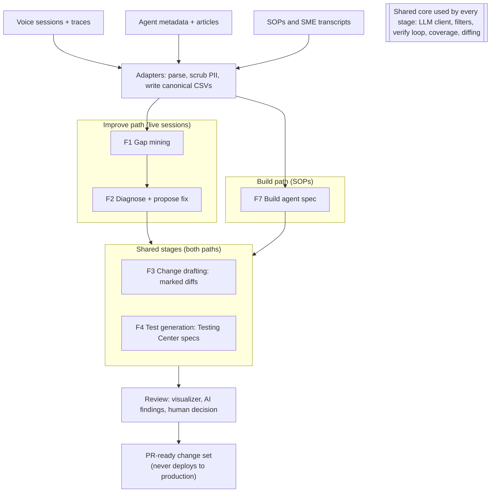
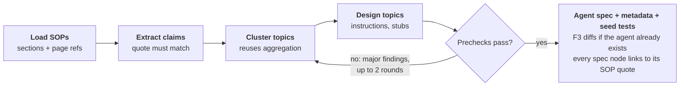

# Ghostwriter for Agentforce Voice: Architecture and Design (F1–F4, F7)

Nov 3, 2026 · Uday Gangireddy · Live, editable version: [Claude Doc](https://claude.ai/artifact/AkZjX4czE9Wqd85c6qJrNP)

This design extends the Knowledge Gap Generation (KGG) pipeline into an agent that improves Agentforce voice agents from live sessions (F1–F4) and builds new ones from SOPs (F7). It reuses KGG's core and adds an Agentforce domain pack, a test generator and a build pipeline. Every change it makes is a reviewable diff; it never deploys to production.

## 1. Purpose and scope

The system has two entry paths that share one core.

1. **Improve path (F1–F4).** It reads production voice sessions and compares what the agent did with a reference, one atomic claim at a time. It then clusters the recurring gaps, diagnoses each cluster against the agent's current configuration, drafts the fix as a diff, and writes regression tests that reproduce the gap.
2. **Build path (F7).** It reads SOPs, call transcripts or SME interviews and extracts steps, conditions and routing rules as claims. From those it designs topics, instructions, action specs and guardrails. Its output is a draft agent spec plus seed tests, sent through the same drafting (F3) and test generation (F4) as the Improve path.

| Feature | Question it answers | Main output |
| --- | --- | --- |
| F1 Gap mining | Where does the live agent fail, again and again? | Gap themes per topic, review-eligible or watchlist |
| F2 Diagnose and propose fix | Why does it fail, and what change fixes it? | Typed recommendations with evidence |
| F3 Change drafting | What exactly changes? | `[[ADD]]/[[DEL]]` diffs to instructions, metadata and articles |
| F4 Test generation | How do we prove the fix? | Testing Center test specs that fail today |
| F7 Build from SOPs | What should a new agent look like? | Agent spec, topics, instructions, action stubs, seed tests |

**Out of scope for this version:**

- Running tests or simulated callers automatically (F5, F6). Generated tests are loaded into Testing Center by a person.
- Deploying anything to production, and building Flows, Apex or prompt templates. Action specs are stubs a developer implements.
- Real audio. Voice is analysed from transcripts and trace timing; TTS and ASR testing come later.
- Any LLM other than the Copilot-hosted model.

## 2. Design principles

The seven KGG principles still apply. Four new ones cover changing a live agent safely.

**Inherited from KGG**

- **Claims, not documents, are the unit of comparison.** A voice session is broken into atomic claims: facts, steps, routing, actions, escalations and voice behavior.
- **Deterministic code wherever a rule works; the LLM only for judgment.** Filters, recurrence gating, coverage scoring, diff acceptance, test-spec validation and spec linting are plain code.
- **Never silently drop data.** Every filter, exclusion and fallback is recorded with its rule.
- **Model output is untrusted.** Every response is parsed defensively and validated against the evidence it was given. Invalid output degrades to a safe default.
- **Partition by topic.** Each Agentforce topic, plus `__unrouted__`, is processed independently and in parallel.
- **One scope rule.** Only review-eligible themes influence a recommendation, a diff or a test.
- **Resumable and auditable.** Staging files checkpoint per-session results; every output row carries a `run_id`.

**New for agent changes**

- **Changes are diffs, never rewrites.** Every change to instructions, metadata or articles is the original plus marked additions and cross-outs. Stripping the markers must reproduce the original.
- **Tests come from ground truth.** Test assertions come from the reference's claims, never from model-authored text, so a test states what the associate or SOP actually did.
- **A fix is not done until a test proves it.** Each recommendation ships with tests that should fail on the current agent. This version checks that by hand; F5 will check it automatically.
- **A human approves every change.** The system writes PR-ready metadata and drafts. It does not deploy, publish or activate anything.

## 3. System overview

Adapters turn three kinds of raw input into canonical CSVs. The Improve path (F1, F2) and the Build path (F7) then both feed the same drafting (F3) and test generation (F4) stages. Everything ends in human review and a PR-ready change set; nothing is deployed.

<!-- diagram: overview -->

The shared core is KGG's engine made domain-agnostic. The Agentforce voice behavior lives in a domain pack (section 4), so the existing knowledge-article runs keep working on the same core.

## 4. Repository layout and module map

The repo splits into a domain-agnostic core and a domain pack. KGG's knowledge-article behavior becomes one pack (`knowledge`) and Agentforce voice becomes another (`agentforce_voice`), so both run on the same code.

| Path | Role |
| --- | --- |
| `core/` | Domain-agnostic engine ported from KGG: LLM layer, config, filters, claim pipeline, aggregation, verification, eligibility, coverage, diffing |
| `domain/agentforce_voice/` | Claim kinds, change types, outcomes, prompts, stub dispatch phrases, prechecks for voice agents |
| `domain/knowledge/` | The existing KGG behavior as a pack (asset types, article outcomes), so knowledge runs keep working |
| `adapters/` | Raw exports to canonical CSVs: sessions, agent metadata, SOP corpus |
| `pipelines/improve/` | F1–F4 orchestration |
| `pipelines/build/` | F7 orchestration |
| `tools/visualizer/` | Static HTML review tool (themes, recommendations, diffs, tests, agent spec) |
| `tests/` | Offline tests on the stub backend, plus golden files |
| `data/<dataset>/{raw,processed,outputs,backup}` | Inputs, results and run snapshots (git-ignored) |

**Module map**

| Module | Responsibility | Origin |
| --- | --- | --- |
| `core/llm_client.py` | `complete_json(system, user)`; Copilot CLI and stub backends; retry with backoff | KGG `llm_client.py` + retry |
| `core/common.py` | Config (one `--config` for every entry point), logging, CSV helpers, run ids | KGG `common.py` |
| `core/filters.py` | Session- and claim-level rules: `match` + `keep_if` | KGG `interaction_filter.py`, `claim_filter.py` |
| `core/partition.py` | Group by topic, slugs, per-topic paths, `--only-topic` | KGG `intent_split.py` |
| `core/claims.py` | One LLM call per session: claims, kinds, statuses, conditions | KGG `analyze_claims.py` |
| `core/aggregate.py` | Gap pool, theme clustering, chunking above ~130 claims | KGG `aggregate_themes.py` + chunking |
| `core/verify.py` | Prechecks, LLM critique, revise loop, finding routing | KGG `verify_themes.py`, `verify_patterns.py` |
| `core/eligibility.py` | Recurrence gate | KGG `eligibility.py` |
| `core/coverage.py` | Lexical claim-versus-text scoring over any text corpus | KGG `article_coverage.py`, generalized |
| `core/diffing.py` | `[[ADD]]/[[DEL]]` markers, acceptance check, fallback | KGG drafting check, extracted |
| `adapters/agentforce_sessions.py` | Session and trace export to `sessions.csv`, `session_steps.csv` | New |
| `adapters/agent_metadata.py` | Retrieved metadata to `agent_config.csv`; writes diffs back to XML | New |
| `adapters/sop_loader.py` | SOP files (docx, pdf, md, transcripts) to `sop_sections.csv` | New |
| `pipelines/improve/recommend.py` | F2: cluster, score, evidence, recommend, validate | KGG `analyze_patterns.py` |
| `pipelines/improve/draft.py` | F3: per-target drafting | KGG drafting functions |
| `pipelines/tests/generate_tests.py` | F4: themes or spec to Testing Center test specs | New |
| `pipelines/build/build_agent.py` | F7: SOP to agent spec | New |
| `domain/agentforce_voice/prompts.py` | Every system and user prompt for the voice pack | New, KGG prompt style |

## 5. Data contracts

Adapters own every raw format. The pipelines read only the canonical files below, so a change in an export touches one adapter. Agentforce object and field names in the sources are assumptions to confirm against our org.

### 5.1 Inputs

| File | Key columns | Required | Source |
| --- | --- | --- | --- |
| `sessions.csv` | `session_id, topic, channel, started_ts, caller_utterances, agent_transcript, reference_type, reference_text, outcome, escalated` | `session_id`, `agent_transcript` | Agentforce session tracing (Data Cloud export or SOQL) |
| `session_steps.csv` | `session_id, turn, step_type (topic_selected, action_call, retrieval, response), name, input_json, output_json, latency_ms, error` | for routing and action claims | Same trace export |
| `agent_config.csv` | `element_type (agent, topic, instruction, action, article), element_id, parent_id, label, text, api_name` | yes, for F2 and F3 | `sf project retrieve start` for the agent's GenAiPlanner/Bot, GenAiPlugin, GenAiFunction metadata, plus Knowledge articles |
| `retrieved_articles.csv` | `session_id, article_id, article_title, article_text` | optional | Retrieval steps in the trace |
| `sop_sections.csv` | `sop_id, section_id, heading_path, text, source_file, page` | yes, for F7 | `sop_loader.py` over docx, pdf, md or transcripts |

`reference_type` is one of `associate` (a human handled the same request), `sop` (the expected flow from a mapped SOP), or `outcome_only`. With `outcome_only`, only routing, action and escalation claims are judged, from the trace and the session's outcome.

`session_id` is the join key across the session files and to every theme. Rows without an agent transcript are dropped by the loader and counted.

### 5.2 Outputs

| File | Content | Feature |
| --- | --- | --- |
| `processed/<topic>/session_claims.csv` | Per-session claims, kinds, statuses and conditions (staging, checkpointed) | F1 |
| `outputs/<topic>/gap_themes.csv` | Themes with `claim_kind_mix`, eligibility, supporting sessions, `run_id` | F1 |
| `outputs/<topic>/qa_report.json` | Verification iterations, findings, suppressed claims, disposition | F1 |
| `outputs/<topic>/recommendations.json` | Clusters, change type, outcome, targets, evidence, `key_facts`, `expected_behavior`, review status | F2 |
| `outputs/<topic>/drafts/` | One marked diff per target element, plus new-element drafts | F3 |
| `outputs/<topic>/tests/` | Test specs in Testing Center format, plus `tests_index.json` linking each test to its theme | F4 |
| `outputs/build/<agent>/agent_spec.yaml` | Agent, topics, instructions, action stubs, guardrails, each traced to SOP sections | F7 |
| `outputs/build/<agent>/metadata/` | PR-ready metadata generated from the spec | F7 |
| `outputs/_all_topics/run_summary.json` | Per-topic status and counts, exclusions | All |

## 6. F1 — Gap mining

F1 is KGG stage 1 with three changes: sessions replace Q&A pairs, claims carry a kind, and the trace is evidence alongside the transcript. Entry point: `pipelines/improve/run_improve.py --stage mine`.

### 6.1 Session-level exclusion

`core/filters.py` drops whole sessions that carry no learnable behavior. A rule is `match` plus an optional `keep_if` rescue, applied to named fields. The first matching rule wins and is recorded in `excluded_sessions.csv`.

| Rule | Excludes | Rescued when |
| --- | --- | --- |
| `caller_hangup_early` | The caller left before the first agent turn finished | never |
| `test_or_internal` | Test numbers, internal QA callers | never |
| `silent_or_noise` | Fewer than two caller utterances with content | the trace shows an action call |
| `cobrowse_resolution` (KGG) | Resolved by co-browse or screen share | never |

Excluding sessions lowers the recurrence denominator, as in KGG.

### 6.2 Partitioning

Sessions are grouped by the topic the agent selected first, plus `__unrouted__` for sessions where no topic was selected or the agent fell back to a default. A session that switched topics is filed under its first topic, and each switch becomes a routing claim. `--only-topic` restricts a run.

### 6.3 Claim extraction and comparison (1 LLM call per session)

The model breaks the reference and the agent's behavior into atomic claims, each with a **kind**, then classifies every reference claim as `matched`, `missing`, `contradicted` or `condition_mismatch`. The trace steps are in the prompt, so routing and action claims are judged on what the agent actually did, not only on what it said.

| Kind | Example reference claim | Judged from |
| --- | --- | --- |
| `fact` | "The direct deposit cutoff is 2 business days before the check date" | Agent transcript |
| `step` | "Ask for the last four digits of the account before reading the balance" | Transcript order |
| `routing` | "This request belongs in Payroll Changes, not General FAQ" | `topic_selected` steps |
| `action` | "Look up the employee record with the employee id" | `action_call` steps, inputs and errors |
| `escalation` | "Transfer to the tax team when a state notice is involved" | Transfer or escalation steps |
| `voice_ux` | "Read the amount as dollars and cents, in one short sentence" | Transcript, turn length, latency |

With `reference_type = outcome_only` there is no reference text. The model then judges only `routing`, `action` and `escalation` claims, against the session outcome (for example, escalated or abandoned). Conditions (`condition`, `condition_kind`) are tagged per claim exactly as in KGG 7.7a. Results are checkpointed every 10 sessions; `--resume` skips finished sessions.

### 6.4 Gap pool and stop-claim filter

Missing, contradicted and condition-mismatch claims form the pool, with ids `<session_id>::<kind>::<index>`. Default voice rules suppress boilerplate:

| Rule | Suppresses | Rescued when |
| --- | --- | --- |
| `generic_escalation` (KGG) | "contact support" | it names a team or a trigger condition |
| `ivr_boilerplate` | menu prompts, "press 1", recording notices | never |
| `hold_and_filler` | hold notices, "are you still there", "one moment" | never |
| `pleasantries` (KGG) | greetings, sign-offs | off by default |

### 6.5 Aggregation, verification and recurrence

Unchanged from KGG 6.5–6.7, with three additions. Aggregation is chunked when the pool exceeds about 130 claims: themes are built per chunk, then merged in one pass. Themes may mix claim kinds, and each carries `claim_kind_mix`. The critique gets one new finding code, `mixed_failure_modes`, for a theme that combines unrelated kinds, such as a routing miss with a fact miss. The recurrence gate keeps its default of 2 sessions.

## 7. F2 — Diagnose and propose fix

F2 is KGG stage 2 with one difference: it can recommend a change to the agent itself, not only to an article. It runs per topic on eligible themes only (KGG scope rule 7.1).

### 7.1 Steps

1. **Rollup and coverage.** As in KGG 7.2: the top sessions, plus the share of the topic's sessions that support an eligible theme.
2. **Cluster themes into failure groups (1 LLM call).** Groups follow the stage of the call where the failure happens: routing, verification, information gathering, action execution, answer, wrap-up and transfer. This replaces KGG's workflow-stage clusters. Unplaced themes get a single-theme cluster.
3. **Score clusters.** Deterministic, as in KGG 7.4, plus the kind mix and the share of sessions that escalated.
4. **Config coverage (deterministic).** `core/coverage.py` scores each missing claim against the texts that governed its own session: the selected topic's classification description and instructions, the descriptions of actions that were called or available, competing topics' descriptions, and retrieved articles. Thresholds stay at 0.70 covered and 0.40 partial. The top five elements per cluster are kept, each with up to three excerpts.
5. **Recommend (1 LLM call per topic).** For each cluster: one change type, one outcome, targets from the shortlist, concrete edits, and a quoted passage wherever it says the config already states something.
6. **Validate** (`_finalize_change`), then **applicability** (KGG 7.7a, one call per cluster).

### 7.2 Change types and outcomes

| Change type | When the root cause is | Outcome | Required content |
| --- | --- | --- | --- |
| `topic_instruction` | The topic is right, but its instructions lack or contradict the rule or step | `update_instructions` | Target topic, concrete instruction edits |
| `topic_scope` | The wrong topic was chosen, or none was | `fix_routing` | The selected and the correct topic; edits to one or both classification descriptions |
| `new_topic` | No topic fits a recurring request | `create_new` | Name, classification description, scope, instructions outline |
| `action_description` | The right action exists but was not called, or was called with wrong inputs | `fix_action_spec` | Target action, description and input edits |
| `new_action` | The step needs a system capability the agent lacks | `create_new` | Action stub: name, purpose, inputs, outputs, error cases |
| `guardrail` | The agent did something it must not do, or skipped a required check | `add_guardrail` | The rule text and where it applies |
| `voice_style` | The content was right but unusable by voice: too long, unreadable numbers, no readback | `update_instructions` | Style rule, scoped to the topic or the agent |
| `knowledge_article` | A missing or wrong fact the agent should retrieve | KGG outcomes: `update_existing`, `create_new`, `retrieval_fix` | As in KGG 7.7 |
| any | The config already states it and a test guard is enough, or the theme is too thin | `add_test_only`, `fold_into_main` | A quoted passage, or the host cluster |

### 7.3 Validation rules (model output is a proposal)

- Targets are kept only if their `element_id` is in the shortlist given to the model.
- `fix_routing` must name two topics, the one selected and the correct one, and both must exist in `agent_config.csv`. Otherwise it becomes `create_new` with change type `new_topic`.
- `fix_action_spec` must target an action available to the selected topic. Otherwise it becomes a `new_action` stub.
- `add_test_only` needs a quoted passage that occurs verbatim in the cited element. Otherwise it becomes `update_instructions`.
- Any outcome with no concrete edit or stub falls back to `update_instructions` on the selected topic and is flagged `needs_review`.
- `key_facts` is always the cluster's missing-claim texts. `expected_behavior` is always built in code from claim kinds: expected topic from routing claims, expected actions from action claims, required statements from fact and step claims.
- **Scope gate** as in KGG 7.7a: a target labelled `different` is dropped. A `broader` target, such as an agent-wide instruction, gets a scoped condition instead of a global rule.

## 8. F3 — Change drafting

F3 turns every recommendation into a reviewable diff on the exact element it changes. It uses one mechanism for every target type: KGG's `[[ADD]]`/`[[DEL]]` markers plus the acceptance check, extracted into `core/diffing.py`.

### 8.1 Drafting per target

| Target | Model receives | Model returns | Notes |
| --- | --- | --- | --- |
| Topic instructions | All of the topic's instructions, the edits, key facts, conditions | The full instruction list with markers | A new instruction is one `[[ADD]]` line; a stale one is wrapped in `[[DEL]]` |
| Classification description and scope | Both topics' descriptions (for `fix_routing`), the misrouted utterances | Both descriptions with markers | Must keep the two topics distinguishable (section 11) |
| Action description and inputs | The action's description and input and output descriptions | Marked text per field | Never changes the API name, types or the implementation |
| Guardrail and voice style | The agent-level or topic-level instructions | A marked addition, scoped by a condition | Voice lint (8.3) runs on the result |
| New topic, new action stub | Title, outline, key facts, expected behavior | Markdown plus a YAML block | Uses `[TBD: ...]` wherever facts are missing |
| Knowledge article | As in KGG 7.8 and 7.9 | As in KGG | Unchanged |

### 8.2 Acceptance check and fallback

A draft is accepted only if it contains at least one marker, and only if removing the ADD blocks and unwrapping the DEL blocks reproduces the original text, ignoring whitespace. If it fails, the code appends the edits as a marked section at the end of the original and sets `draft_status = fallback`. This status is recorded on every draft, which fixes the KGG gap where fallbacks were not tracked.

### 8.3 Voice lint (deterministic)

It runs on every added text that the agent could speak.

- An instruction that would make the agent speak a turn of more than about 40 words, or more than two sentences, gets a minor finding.
- Raw figures that TTS reads badly get a minor finding: unformatted currency, long digit strings, unexpanded acronyms not on an allowlist, or dates like `11/03`.
- An added instruction that asks the caller for more than one item in a single turn gets a minor finding.

The thresholds are in config.

### 8.4 Metadata round trip

`adapters/agent_metadata.py` applies an accepted draft back onto the retrieved metadata files. It writes the text without markers into the right XML field and leaves every other byte unchanged. The output goes to `drafts/<element>/metadata/` as a PR-ready change set. A round-trip test confirms that parsing and writing an unchanged file gives identical bytes.

## 9. F4 — Test generation

F4 writes regression tests for two callers. For the Improve path, a test per eligible theme that reproduces the gap. For the Build path, seed tests per topic in the agent spec. Entry point: `pipelines/tests/generate_tests.py --from themes|spec`.

### 9.1 What a test case holds

| Field | Source | Who writes it |
| --- | --- | --- |
| `utterance` (first caller turn, plus optional follow-up turns) | Paraphrased from the theme's real caller utterances; for F7, from SOP trigger phrases | LLM, checked by code |
| `expected_topic` | Routing claims, or the recommendation's correct topic | Code |
| `expected_actions` | Action claims (name, and key inputs when stated) | Code |
| `expected_response` | Fact and step claims, written as required statements | Code (`expected_behavior`) |
| `must_not` | Contradicted claims and guardrails (for example, "never read the full account number") | Code |
| `conditions` | Applicability constraints (for example, "caller not verified") | Code, from 7.3 |
| `trace` | `theme_id`, `session_ids`, `run_id`, recommendation id | Code |

Only the utterance is model-written. Every assertion is copied from claims, which makes the tests ground truth (section 2).

### 9.2 Utterance generation (1 LLM call per theme)

The model gets the theme's real caller utterances. It returns three to five spoken-style variants: short, rambling, with a disfluency, and with the key detail late. Code then removes PII: names, numbers and account fragments are replaced with typed placeholders from a synthetic-data table. It also drops near-duplicates (token Jaccard of 0.8 or more) and keeps at most five per theme.

### 9.3 Output format

Tests are written in the Agentforce Testing Center format: one test definition per topic, one test case per utterance. The writer is a thin serializer behind an interface, so the exact Testing Center schema is isolated in one module. `tests_index.json` maps each test case to its theme and recommendation so the visualizer can show them together.

### 9.4 Prechecks (deterministic)

- `expected_topic` and every `expected_actions` entry must exist in `agent_config.csv`, or in the F7 spec.
- Every expected-response and `must_not` assertion must equal a source claim's text, or be a substring of it.
- Variants that match a different theme's utterances more closely than their own are flagged `ambiguous_utterance`.
- An improve-path test should fail on the current agent. This version cannot run tests, so it marks each test `expected_to_fail_today = true` for a person to confirm. F5 will check it automatically.

## 10. F7 — Build agent from SOPs

F7 runs the claim machinery the other way round. It extracts the claims an SOP makes, then clusters them into topics instead of gaps. Each topic gets instructions, action stubs, guardrails and seed tests. Every element of the spec is traced to the SOP sections it came from. Entry point: `pipelines/build/build_agent.py --sops <dir> --agent-name <name>`.

<!-- diagram: f7-build-flow -->

A topic that fails a major precheck goes back to clustering, at most twice. A topic still failing after that is written but flagged `needs_review`.

### 10.1 Steps

1. **Load SOPs** (`sop_loader.py`). Converts docx, pdf, md and transcripts into sections that keep their heading path and page. Images and tables become text with a `[TABLE]` or `[FIGURE]` note; a figure that cannot be read is listed in the QA report.
2. **Extract procedure claims (1 LLM call per section).** Kinds: `trigger` (what a caller asks for), `step`, `condition`, `fact`, `action_need` (needs data or a system), `routing` (hand-off to a person or team), `prohibition` (must never), `voice_ux`. Each claim keeps `sop_id`, `section_id` and a verbatim quote, and code drops any claim whose quote is not in the section.
3. **Cluster into topics (reusing `core/aggregate.py`).** Triggers plus their steps are grouped into job-to-be-done topics. Steps in different topics are cross-checked so that one step lives in one place. The verify loop applies, with build-specific findings (section 11).
4. **Design each topic (1 LLM call per topic).** It returns a classification description, scope (in and out), ordered instructions written from steps and conditions, guardrails from prohibitions, and voice rules.
5. **Derive action stubs (deterministic grouping plus 1 LLM call).** Matching `action_need` claims are merged into one stub with name, purpose, inputs, outputs and error cases. Stubs are matched against existing actions in `agent_config.csv` when an org is connected, and a match is reused, not duplicated.
6. **Agent-level settings.** Greeting, identity verification, transfer rules, global guardrails and voice style come from claims that apply across topics.
7. **Seed tests (F4 `--from spec`).** Three to five tests per topic from triggers and steps, plus one negative routing test per pair of neighboring topics.
8. **Write outputs.** `agent_spec.yaml` (human-readable, the reviewed artifact) and PR-ready metadata generated from it. When the agent already exists, each element is written as an F3 diff against it instead of new files.

### 10.2 Build-specific prechecks

| Check | Severity | Rule |
| --- | --- | --- |
| `sop_step_uncovered` | major | Every `step`, `condition` and `prohibition` claim appears in some instruction, guardrail or stub |
| `topic_overlap` | major | Two classification descriptions overlap 0.6 or more by token Jaccard, or a test utterance fits both |
| `orphan_action` | minor | A stub no instruction refers to |
| `ungrounded_instruction` | major | An instruction with a figure, rule or path that no claim states |
| `condition_lost` | major | A claim with a condition appears in an instruction without that condition |
| `sop_conflict` | major | Two SOP sections give different outcomes for the same trigger; this is surfaced for a policy owner, never resolved by the model |
| `voice_lint` | minor | The F3 voice lint, applied to instructions and greetings |

Major findings send their topic back to step 3 or 4 within the iteration budget (default 2). Remaining majors leave the spec at `needs_review`.

## 11. AI review extensions

The KGG review structure stays the same: free deterministic prechecks, one LLM critique per topic, and only major findings trigger a revision, routed to the step that can fix them. Every KGG finding code carries over. The new codes are below.

| Code | Feature | Severity | Raised when | Routed to |
| --- | --- | --- | --- | --- |
| `mixed_failure_modes` | F1 | major (critique) | A theme combines unrelated claim kinds | Re-aggregate |
| `wrong_change_type` | F2 | major | For example, `topic_instruction` chosen while the trace shows the wrong topic was selected | Re-recommend |
| `routing_without_competitor` | F2 | major | `fix_routing` without the topic that was wrongly chosen | Re-recommend |
| `nonexistent_target` | F2 | major | Target topic or action not in the config | Re-recommend |
| `global_rule_for_local_gap` | F2 | minor | An agent-wide instruction for a gap seen in one topic | Note |
| `marker_check_failed` | F3 | minor | Draft fell back to an appended section | Redraft |
| `voice_lint` | F3, F7 | minor | Voice lint findings (8.3) | Note |
| `ungrounded_edit` (KGG) | F3, F7 | major | Figures, paths or rules in a draft that no claim or original text states | Redraft |
| `ungrounded_assertion` | F4 | major | A test assertion not equal to a claim | Regenerate tests |
| `ambiguous_utterance` | F4 | minor | A variant fits another theme or topic better | Regenerate tests |
| `sop_step_uncovered`, `topic_overlap`, `condition_lost`, `sop_conflict`, `ungrounded_instruction` | F7 | major | See 10.2 | Re-cluster or re-design the topic |

The critique prompt gains three questions. Does the chosen change type match what the trace shows? Would the drafted instruction change what the agent says or does in the cited sessions? Would the tests fail today and pass after the change?

The verdict rules are as in KGG: each recommendation and the topic as a whole are `accepted` or `needs_review`, and the LLM's own verdict is recorded but never flips the status.

## 12. Review tooling

The KGG recommendation visualizer stays a static, self-contained HTML file. It gains four views, all keyed by `run_id`.

- **Filters:** topic, change type, outcome, review status, `draft_status`.
- **Diff pane:** instruction, description and metadata diffs, with additions in green and cross-outs in red beside the evidence claim and sessions.
- **Test pane:** the theme's test cases, with assertions linked to the claims they came from and the `expected_to_fail_today` flag for a reviewer to confirm.
- **Agent spec tree (F7):** agent, then topics, then instructions, guardrails, actions and tests. Each node links to its SOP quote, and findings are shown on the node.

Reviewer decisions (accept, reject, edit, notes) export as JSON, and `merge_feedback.py` folds them back. Accepted changes are then bundled by `tools/export_changeset.py` into one metadata change set per topic, ready for a PR.

## 13. Configuration and failure model

There is one config file for every entry point: `--config` is required, and its timeouts and thresholds apply to every stage. This removes the KGG gotcha where `analyze_patterns.py` ignored the config.

| Setting | Default | Notes |
| --- | --- | --- |
| `domain` | `agentforce_voice` | `knowledge` reproduces KGG |
| `backend` / `model` | `copilot` / `auto` | `stub` for tests |
| `timeout_seconds` | 180 per call; 900 aggregate; 600 recommend and draft | Per stage |
| `retries` / `backoff_seconds` | 3 / 2, 8, 30 | New: retries network and auth-validation errors only |
| `max_workers` | 4 | Per-topic parallelism |
| `min_sessions_for_review` | 2 | Recurrence gate |
| `aggregate_chunk_size` | 120 claims | New |
| `max_verify_iterations` / `max_pattern_iterations` / `max_build_iterations` | 2 / 2 / 2 | 0 means flag only |
| `voice_lint` | 40 words, 2 sentences, acronym allowlist | Thresholds |
| `exclude_sessions`, `ignore_claims` | Defaults in 6.1 and 6.4 | `mode: extend` or `replace` |

**Failure model.** As in KGG 4.3, failures are handled at the lowest sensible level.

| Call | On failure |
| --- | --- |
| Per-session claims | Retried, then logged and skipped |
| Per-SOP-section claims | Retried, then logged and skipped; listed as uncovered |
| Aggregation | Retried, then the topic is marked failed and other topics continue |
| Critique | Treated as `pass`, disposition `accepted_review_failed` |
| Draft | Fallback marked section, `draft_status = fallback` |
| Utterance generation | The theme's real utterances (PII-scrubbed) are used as-is |
| Topic design (F7) | Topic marked failed; spec written without it and flagged |

A run exits non-zero if any topic failed. Reports are written only on success, so an earlier report survives.

## 14. Safety and governance

- **No production writes.** The system has no credentials for production orgs. Metadata retrieval uses a read-only integration user. Output is files and a PR, never a deploy or an activation.
- **PII.** Transcripts are scrubbed for PII in the adapter before any LLM call. Names, phone numbers, account and card fragments, SSNs and addresses become typed placeholders, and the raw files never leave the restricted data folder. Test utterances use synthetic values only.
- **Grounding.** Every instruction, edit and assertion is traced to a claim, and every claim to a quote in a session or an SOP. Ungrounded content is a major finding.
- **Policy conflicts.** Conflicting sources (`contradiction`, `sop_conflict`) are surfaced to a named policy owner and never resolved by the model.
- **Audit.** `run_id`, model, prompt version and config hash are stored on every output row.

## 15. Testing strategy and pilot

**Offline suite (stub backend), in the KGG style.** Each module has tests that assert its output contract.

- Adapters: messy trace exports, header drift, PII scrubbing, metadata round trip (byte-identical when unchanged), SOP loading of docx, pdf and md.
- F1: topic partitioning with `__unrouted__`; claim kinds from trace steps; voice stop-claim rules with `keep_if` rescue; chunked aggregation; recurrence gate.
- F2: config coverage against instructions; every validation fallback in 7.3; scope gate.
- F3: marker acceptance and fallback per target type; voice lint thresholds.
- F4: assertions equal claim text; unknown topic or action rejected; PII-free utterances; dedup.
- F7: uncovered SOP step, topic overlap, lost condition, ungrounded instruction and SOP conflict are each caught; the iteration budget stops.
- Golden files: one small anonymized dataset per path, with expected outputs checked in.

The stub dispatch phrases in `domain/agentforce_voice/prompts.py` form an interface, as in KGG, and a test fails if they drift.

**Pilot.**

1. **Improve:** one topic, 50 to 100 sessions. Exit criteria: reviewers accept at least half of the recommendations without major edits; generated tests fail on today's agent; after a reviewer applies one fix by hand in a sandbox, its tests pass.
2. **Build:** one SOP set for a small agent of 3 to 5 topics. Exit criteria: no uncovered SOP steps; reviewers accept the topic split; seed tests pass in a sandbox after the spec is deployed there by hand.

## 16. Open decisions and risks

- [ ] **Code base:** port KGG into this repo as `core/` plus a `knowledge` pack, or rebuild from the design doc? This design assumes the port.
- [ ] **Session data access:** Data Cloud export, SOQL or CSV, and who provides the read-only integration user.
- [ ] **Reference for "correct":** associate calls, SOPs mapped to topics, or outcome only. This decides how many claim kinds F1 can judge.
- [ ] **Agent definition format:** classic topic and action metadata, or Agent Script. Only `agent_metadata.py` and the F7 writer depend on it.
- [ ] **Testing Center format and version** to target in F4.
- [ ] **LLM budget:** Copilot CLI throughput for per-session and per-section calls at production volume.

**Risks**

| Risk | Effect | Mitigation |
| --- | --- | --- |
| Trace data is incomplete or not exported | Routing and action claims cannot be judged | Fall back to transcript-only claims; flag the topic as low-evidence |
| Lexical coverage misses paraphrases | Wrong change type (KGG limitation) | The LLM must quote; `wrong_change_type` critique |
| Generated instructions bloat topics | Worse routing and latency | Voice lint, `global_rule_for_local_gap`, reviewer diff view |
| SOPs are outdated or conflict | F7 builds the wrong behavior | `sop_conflict` surfaced to the policy owner; every spec node links to its quote |
| High `needs_review` rate, as in KGG (70 of 122) | Reviewer fatigue | Only majors block; sort by sessions affected; pilot tunes thresholds |
