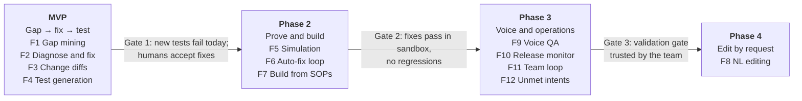

# Ghostwriter for Agentforce Voice: Feature Catalog

Nov 3, 2026 · Uday Gangireddy · Live, editable version: [Claude Doc](https://claude.ai/artifact/UGEXD4f72REwqEMRsbovqc)

## Purpose and background

This catalog lists 12 features for an agent that builds, tests, diagnoses and improves Agentforce voice agents, so we can choose a starting set. The recommended start is F1–F4. That set reuses about 70% of the existing Knowledge Gap Generation (KGG) pipeline.

Ghostwriter is a [Sierra](https://sierra.ai/product/ghostwriter) product, not a Cyara one. Sierra describes it as "the agent that creates and optimizes other agents": it builds from SOPs and transcripts, simulates every change, diagnoses failures and proposes fixes. Cyara's AI-agent testing tools could later supply the real voice-call test layer.

KGG already does the "monitor → diagnose → propose fix" half. It compares claims, clusters recurring gaps, gathers article evidence, recommends typed outcomes, drafts `[[ADD]]/[[DEL]]` changes and runs an AI review. The missing half is building from SOPs and simulating before release.

## All features at a glance

Four of the twelve features reuse KGG heavily. Those four form the MVP.

| # | Feature | One-line description | KGG reuse | Phase |
| --- | --- | --- | --- | --- |
| F1 | Production gap mining | Find and cluster recurring failures in real voice sessions | High | MVP |
| F2 | Diagnose and propose fix | Classify root cause and propose a typed fix per recurring failure | High | MVP |
| F3 | Change drafting (diff) | Write each fix as a reviewable diff to articles, topics, instructions, actions | High | MVP |
| F4 | Test generation | Turn each recurring failure into regression test cases | Medium | MVP |
| F5 | Simulation and validation | Run tests and simulated callers against a sandbox agent, before and after a change | Low | Phase 2 |
| F6 | Auto-fix loop | Diagnose a failed simulation, revise the fix, re-simulate within a budget | Medium | Phase 2 |
| F7 | Build agent from SOPs | Generate topics, instructions, action stubs and seed tests from SOPs or transcripts | Low | Phase 2 |
| F9 | Voice-specific QA | Check TTS-friendliness, length, barge-in, silence, ASR mishears, transfers | Low | Phase 3 |
| F10 | Release monitoring and experiments | Confirm a shipped fix stops the gap recurring; flag regressions | Medium | Phase 3 |
| F11 | Team loop | Send evidence and proposed changes to Slack or Teams for approval, then follow up | Medium | Phase 3 |
| F12 | Opportunity discovery | Find intents the agent cannot route or handle at all | Medium | Phase 3 |
| F8 | Natural-language editing | Turn a plain-language request into a metadata diff plus tests | Low to medium | Phase 4 |

## Feature details

Each card gives what the feature does, its inputs and outputs, where it touches Agentforce, voice-specific points, what it reuses from KGG, and what it depends on. Agentforce object and metadata names are to be confirmed against our org.

### F1 — Production gap mining

- **What it does:** compares what the voice agent did with a reference (associate handling, SOP or expected test outcome) at the level of atomic claims. It then clusters the recurring misses into narrow themes.
- **Inputs:** voice session transcripts plus traces (topic chosen, actions called, action inputs and outputs, latency); the reference answer or SOP.
- **Outputs:** gap themes per topic with eligibility, supporting sessions and a QA report.
- **Agentforce touchpoints:** session tracing data (Data Cloud export); partition by Agentforce topic plus an `__unrouted__` partition.
- **Voice points:** new claim kinds `routing`, `action`, `escalation`, `voice_ux`; boilerplate filters for IVR prompts, hold and "are you still there".
- **KGG reuse:** high. Reuses `analyze_claims`, `claim_filter`, `interaction_filter`, `aggregate_themes`, `verify_themes`, `eligibility`. A new adapter is needed.
- **Depends on:** access to session data.

### F2 — Diagnose and propose fix

- **What it does:** for each eligible theme cluster, gathers evidence from the agent's current config and recommends one typed fix.
- **Inputs:** eligible themes; agent config sidecar (topic scope and instructions, action descriptions, retrieved Data Library articles).
- **Outputs:** recommendations with change type and outcome: `update_instructions`, `fix_routing`, `fix_action_spec`, `add_guardrail`, `voice_style`, `update_existing` or `create_new` article, `retrieval_fix`, `add_test_only`.
- **Agentforce touchpoints:** GenAiPlanner/Bot, GenAiPlugin (topics) and GenAiFunction (actions) metadata, retrieved with `sf project retrieve start`.
- **Voice points:** applicability constraints map onto topic conditions (for example, the caller is not verified yet).
- **KGG reuse:** high. `article_coverage` becomes `config_coverage`; the `_finalize_article_outcome` validation pattern carries over.
- **Depends on:** F1.

### F3 — Change drafting (diff)

- **What it does:** writes each fix as a reviewable diff, never a silent rewrite.
- **Inputs:** recommendations plus the original article, instruction or metadata text.
- **Outputs:** `[[ADD]]/[[DEL]]` marked drafts that pass the check "stripping the markers reproduces the original"; new-article and new-topic drafts with `[TBD]` markers.
- **Agentforce touchpoints:** topic instruction text, classification description, action input and output descriptions, Knowledge articles.
- **Voice points:** drafts flag replies that are too long or hard for TTS to read aloud.
- **KGG reuse:** high. Reuses `draft_updated_articles`, `draft_new_articles` and the acceptance check.
- **Depends on:** F2.

### F4 — Test generation

- **What it does:** turns every eligible theme into regression tests that should fail on today's agent and pass once the fix is in.
- **Inputs:** themes, claims, real caller utterances.
- **Outputs:** Testing Center test specs: utterance, expected topic, expected actions, expected response checks.
- **Agentforce touchpoints:** Agentforce Testing Center (`sf agent test create`).
- **Voice points:** paraphrased spoken-style utterances, including disfluencies and partial phrases.
- **KGG reuse:** medium. The tests' ground truth comes from claims, the same way `key_facts` does.
- **Depends on:** F1.

### F5 — Simulation and validation

- **What it does:** runs the generated tests and simulated multi-turn callers against a sandbox agent, before and after a change. A change is accepted only when its new tests pass and nothing else regresses.
- **Inputs:** test specs, caller personas, a sandbox or scratch org with the change deployed.
- **Outputs:** pass or fail per test, transcripts, a regression report, and test results as a third layer of `review_status`.
- **Agentforce touchpoints:** `sf agent test run`; `sf agent preview` or the Agent API for multi-turn simulation.
- **Voice points:** text-level first; real TTS and ASR calls come later through a voice test harness, possibly Cyara.
- **KGG reuse:** low. A new simulator gets a pluggable interface like `llm_client`, with `testing_center`, `agent_api`, `voice` and `stub` backends.
- **Depends on:** F3, F4, sandbox access.

### F6 — Auto-fix loop

- **What it does:** when a simulation fails, diagnoses why, revises the change and simulates again, within an iteration budget.
- **Inputs:** failing test transcripts, the current draft.
- **Outputs:** a revised draft, iteration history, and a final verdict of `accepted` or `needs_review`.
- **Agentforce touchpoints:** sandbox deploy plus test run per iteration.
- **Voice points:** none specific.
- **KGG reuse:** medium. The rubber-duck revise loop with major and minor finding routing carries over.
- **Depends on:** F5.

### F7 — Build agent from SOPs

- **What it does:** generates a first agent design from SOPs, call transcripts or SME interviews.
- **Inputs:** SOP documents, transcripts, audio interviews.
- **Outputs:** topics with classification descriptions and instructions, action specs (stubs a human builds as Flow or Apex), and seed tests.
- **Agentforce touchpoints:** `sf agent generate agent-spec`, `sf agent create`, topic and action metadata.
- **Voice points:** greeting, verification, confirmation-readback and transfer patterns built in.
- **KGG reuse:** low. New generation path; reuses prompts and validation patterns.
- **Depends on:** F4 for seed tests; F5, in the same phase, validates what it builds.

### F8 — Natural-language editing

- **What it does:** turns a plain-language request, such as "confirm the account number before transferring", into a targeted metadata diff plus tests.
- **Inputs:** the request plus the current agent config.
- **Outputs:** a diff, new tests, and simulation results.
- **Agentforce touchpoints:** topic instructions and action metadata.
- **Voice points:** none specific.
- **KGG reuse:** low to medium. Reuses F3 drafting and the F5 validation gate.
- **Depends on:** F3, F5.

### F9 — Voice-specific QA

- **What it does:** checks behavior only a voice channel has.
- **Inputs:** transcripts, timing data, recordings where available.
- **Outputs:** voice findings such as reply too long, unreadable number or date or acronym, barge-in mishandled, silence timeout, ASR mishear not recovered, bad transfer or escalation.
- **Agentforce touchpoints:** Agentforce Voice settings (voice, pronunciation, tone), transfer and escalation config.
- **Voice points:** this is the voice feature.
- **KGG reuse:** low. New claim types and deterministic checks (for example, word count per turn).
- **Depends on:** F1.

### F10 — Release monitoring and experiments

- **What it does:** after a change ships, reruns gap mining on post-release sessions to confirm the theme stops recurring and to flag regressions.
- **Inputs:** sessions before and after a release, tagged with `run_id` and release id.
- **Outputs:** a before-and-after recurrence report per theme, plus regression alerts.
- **Agentforce touchpoints:** agent version and release history.
- **Voice points:** none specific.
- **KGG reuse:** medium. The pipeline reruns per `run_id`; the backup-snapshot comparison carries over.
- **Depends on:** F1, a release history.

### F11 — Team loop

- **What it does:** sends evidence and the proposed change to Slack or Teams, captures approve or reject, and follows the outcome.
- **Inputs:** recommendations, drafts, test results.
- **Outputs:** messages with a decision link, and recorded decisions.
- **Agentforce touchpoints:** a PR to the metadata repo when approved; never a direct production deploy.
- **Voice points:** none specific.
- **KGG reuse:** medium. The recommendation visualizer's feedback export becomes a workflow.
- **Depends on:** F2, F3.

### F12 — Opportunity discovery

- **What it does:** finds calls the agent could not route at all, or that escalated with no matching topic, and proposes new topics.
- **Inputs:** sessions from the `__unrouted__` partition and escalations.
- **Outputs:** clusters of unmet intents with a proposed new topic and its volume.
- **Agentforce touchpoints:** topic classification descriptions.
- **Voice points:** none specific.
- **KGG reuse:** medium. Theme clustering and the recurrence gate apply unchanged.
- **Depends on:** F1.

## Recommended start and roadmap

Start with F1–F4. They run on data we already have and produce fixes plus tests that people can check by hand in Testing Center. Phase 2 automates that check in a sandbox and adds building agents from SOPs (F7). Together, that is the step that makes this a Ghostwriter.

<!-- diagram: roadmap -->

Each gate must pass before the next phase starts. F7 sits in Phase 2 next to F5, so every agent it builds is proven in the sandbox before review. F8 comes last.

The first build's design (F1–F4 plus F7) is in [architecture-design-f1-f4-f7.md](architecture-design-f1-f4-f7.md).

## Open questions

- [ ] Which features make the first version: F1–F4 as recommended, or a different set?
- [ ] What is the reference for "correct" behavior: associate calls, SOPs, existing Testing Center cases, or a mix?
- [ ] How do we get Agentforce session traces: Data Cloud export, SOQL, or a manual CSV?
- [ ] Does the KGG code move into SutraAI and get generalized, or do we rebuild a domain-agnostic core from the design doc?
- [ ] Which sandbox or scratch org can F5 deploy to, and who approves promotion to production?
- [ ] Is Copilot CLI still the only allowed LLM, given simulated callers need many more calls?

## Sources

- [Sierra — Ghostwriter product page](https://sierra.ai/product/ghostwriter)
- Knowledge Gap Generation design document, status 10/29/2026 (internal)
